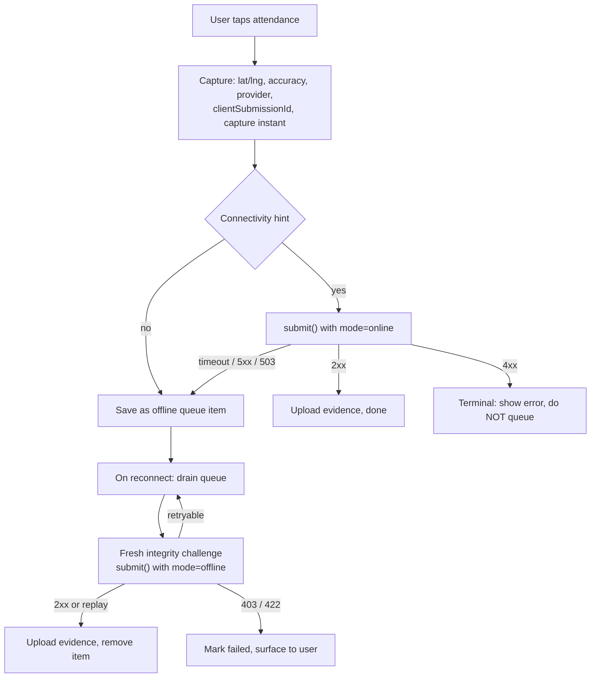

# GPS Attendance — `fio_backend_client`

> Guide to the GPS attendance flow in the Dart client: submission modes, idempotency,
> evidence upload, and the contract for an app-side offline queue.

Related: [Location Monitoring](./location_monitoring.md) · [Google Play Integrity](./google_play_integrity.md) · [Apple App Attest](./gps_attendance_apple_app_attest.md)

---

## Table of Contents

1. [Overview](#1-overview)
2. [Endpoints](#2-endpoints)
3. [Prerequisites](#3-prerequisites)
4. [Submission Modes](#4-submission-modes)
5. [Flow A — Online Submission](#5-flow-a--online-submission)
6. [Flow B — Offline Capture / Deferred Submission](#6-flow-b--offline-capture--deferred-submission)
7. [Idempotency and Retries](#7-idempotency-and-retries)
8. [Evidence Upload](#8-evidence-upload)
9. [Error Handling](#9-error-handling)
   - 9.1 [When the Server Is Unreachable](#91-when-the-server-is-unreachable)
10. [App-Side Outbox Contract](#10-app-side-outbox-contract)
11. [Complete Example](#11-complete-example)
12. [Model Reference](#12-model-reference)

---

## 1. Overview

GPS attendance records a presence event (check-in, check-out, break, overtime) with
the device coordinates. The backend verifies device integrity, decides whether the
record can be approved automatically, and stores the provenance of the submission.

Two submission paths exist:

| Path | When | What the client sends |
|---|---|---|
| **Online** | The device has a usable connection and submits immediately | `mode: online` — the server stamps the attendance with its own clock |
| **Offline / deferred** | The record was captured without a connection, or an immediate attempt failed and is being retried | `mode: offline` + `recorded_at` (the capture instant) |

The package provides the HTTP layer and the models. **It does not persist a queue** —
the application owns storage and retry scheduling. Section 10 defines the contract
the app should implement.



---

## 2. Endpoints

| Method | Endpoint | Client method |
|---|---|---|
| `GET` | `/mobile/v1/gps-attendance/settings` | `client.gpsAttendance.getSettings()` |
| `POST` | `/mobile/v1/gps-attendance` | `client.gpsAttendance.submit(request)` |
| `POST` | `/mobile/v1/gps-attendance/{id}/evidence` | `client.gpsAttendance.uploadEvidence(...)` |
| `GET` | `/mobile/v1/integrity/challenge` | `client.integrity.getChallenge()` |
| `POST` | `/mobile/v1/ios/attest` | `client.integrity.registerIosKey(...)` |

All requests use the company access token and the `X-Company-ID` context handled by
`MobileApiClient.setCurrentCompany()`.

---

## 3. Prerequisites

1. **Company session.** `client.setBackendBaseUrl(...)` and
   `client.setCurrentCompany(companyId)` after issuing the company token.
2. **Company settings.** Call `getSettings()` before showing the capture screen.
   It tells you whether offline capture is offered (`offlineEnabled`), how far back a
   deferred submission may be dated (`maxBackdateHours`), and how long evidence may
   be uploaded (`evidenceUploadTtlSeconds`).
3. **Integrity challenge.** Every submission needs a server-issued nonce:
   - Android: pass it as `requestHash` to `StandardIntegrityManager`, put the token
     in `integrityToken`.
   - iOS: pass it as the nonce to `generateAssertion()`, put the assertion in
     `integrityToken` and the key id in `integrityKeyId`. Register the key once with
     `client.integrity.registerIosKey(...)`.
   - The nonce is single-use and short-lived (about 60 s), so fetch a **fresh**
     challenge for every attempt, including retries.
   - `debug: true` bypasses the check in the backend's development environment only.

---

## 4. Submission Modes

```dart
enum GpsAttendanceMode { online, offline }
```

| `mode` | `recorded_at` | Server behaviour |
|---|---|---|
| `online` | not sent | Attendance time = server time |
| `offline` | required | Attendance time = `recorded_at`, bounded by the backend window |

Prefer the named constructors — they make an invalid combination impossible:

```dart
// Immediate submission
SubmitGpsAttendanceRequest.online(
  attendanceType: AttendanceType.checkIn,
  latitude: lat,
  longitude: lng,
  clientSubmissionId: submissionId,
);

// Deferred submission
SubmitGpsAttendanceRequest.offline(
  attendanceType: AttendanceType.checkIn,
  latitude: lat,
  longitude: lng,
  clientSubmissionId: submissionId,
  recordedAt: capturedAt, // UTC
);
```

The backend rejects `mode=online` with `recorded_at` (`400`) and `mode=offline`
without it (`400`), so do not send both.

---

## 5. Flow A — Online Submission

```dart
final submissionId = _newUuid(); // generate ONCE per capture, reuse on retries
final capturedAt = DateTime.now().toUtc();

final challenge = await client.integrity.getChallenge();

final result = await client.gpsAttendance.submit(
  SubmitGpsAttendanceRequest.online(
    attendanceType: AttendanceType.checkIn,
    latitude: lat,
    longitude: lng,
    clientSubmissionId: submissionId,
    accuracyMeter: fix.accuracy,
    provider: fix.provider, // gps | network | fused | passive
    wifiSsid: wifi?.ssid,
    wifiMacAddress: wifi?.bssid,
    integrityPlatform: IntegrityPlatform.android,
    integrityToken: playIntegrityToken,
    integrityChallenge: challenge.challenge,
  ),
);

// Evidence is uploaded separately, using the returned token.
await client.gpsAttendance.uploadEvidence(
  attendanceLogId: result.attendanceLog.id,
  uploadToken: result.uploadToken!,
  frontPhoto: await MultipartFile.fromFile(selfiePath, filename: 'selfie.jpg'),
  note: note,
);
```

A `201` means the record was created. `result.replayed` is `false`.

---

## 6. Flow B — Offline Capture / Deferred Submission

"Offline" here means **captured without a connection and submitted later**. The
submission itself still requires connectivity, because the integrity challenge is
issued by the server at submit time.

The two values that must survive the queue are:

| Value | Why |
|---|---|
| `clientSubmissionId` | Stable idempotency key. Regenerating it on retry creates a duplicate record |
| `capturedAt` | The real attendance time. Without it the retry would be stamped with the sync time |

Recommended decision rules for the capture screen:

| # | Connectivity hint | Attempt result | Queue? | Sent on retry |
|---|---|---|---|---|
| 1 | offline | not attempted | **Yes** | `mode=offline`, `recorded_at = capturedAt` |
| 2 | online | `2xx` | No — done | — |
| 3 | online | `400` / `401` / `403` / `422` | **No — terminal** | show the error |
| 4 | online | timeout / connection error / `5xx` / `503` | **Yes** | same id, `mode=offline`, `recorded_at = capturedAt` |
| 5 | any | `409` with `existing_attendance_log_id` | No — already recorded | remove the item |

Row 4 matters most: a timeout is **not** a failure, the backend may have committed.
Re-declaring the item as `offline` keeps the real capture time, and idempotency
returns the original record if it already exists.

Draining rules:

- Fetch a fresh integrity challenge for **each** item.
- Drain FIFO per employee, never in parallel — `CHECK_IN` must land before `CHECK_OUT`.
- Back off exponentially with jitter; after a configurable attempt count mark the
  item `failed` and tell the user. Never drop it silently.
- Stop retrying an item that would exceed `maxBackdateHours`; mark it `failed`.
- Drain on: connectivity regained, app resumed, any successful API call, manual retry.

> **Single-offline-path note:** the backend keeps account-level bounds. A deferred
> submission younger than the recovery window (15 minutes by default) does not need
> the `gps_offline` feature; older ones do, and return `403` when the employee does
> not have it.

---

## 7. Idempotency and Retries

`clientSubmissionId` is the idempotency key. The backend stores it with the record
and maps it to `(company, employee)`.

| Situation | Backend response | Client action |
|---|---|---|
| First submission | `201` + `attendance_log`, `upload_token` | continue normally |
| Retry with the same id | `200` + the **original** record, token reissued; `response.replayed == true` | treat as success |
| Concurrent duplicate | `200` after the winner commits, or `409` with `existing_attendance_log_id` | treat as success |
| Same id, different `attendance_type` | `200` with the original record, warning logged server-side | treat as success |

Because a replay reissues an evidence token, a client that lost the first response
can still upload its photo. Do **not** re-submit only to obtain a token if the
original response was received — use the token it returned.

---

## 8. Evidence Upload

Evidence (selfie, additional photos, attachments) is uploaded **after** the
attendance record exists, using the one-time token from the submit response.

```dart
await client.gpsAttendance.uploadEvidence(
  attendanceLogId: id,
  uploadToken: token,
  frontPhoto: front,                 // at most one; required when the company requires it
  backPhotos: backs,                 // at most maxAdditionalPhotoNumber
  attachments: files,                // at most maxAttachmentNumber
  note: note,
  onSendProgress: (sent, total) => ...,
);
```

| Rule | Value |
|---|---|
| Token lifetime | `evidenceUploadTtlSeconds` from `getSettings()` (48 h by default) |
| Token use | Single use — it is deleted after a successful request |
| Rejected request | Does **not** consume the token; fix the payload and retry |
| `front_photo` | At most one |
| `back_photos` | At most `maxAdditionalPhotoNumber` |
| `attachments` | At most `maxAttachmentNumber` |
| Photo size | 25 MB per file |
| Attachment size | 100 MB per file |
| `note` | Persisted at submit time; the upload updates it |

The response is the stored `AttendanceLogMetadata` (URLs, note, distance, WiFi).
When the company requires a photo or attachment and none is uploaded, the record
stays without complete evidence until the window expires.

---

## 9. Error Handling

`ApiError.fromDioException` wraps every failure. Classify before deciding to retry:

| Status | Meaning | Retry? |
|---|---|---|
| `400` | Invalid payload, mode/`recorded_at` mismatch | No |
| `401` | Token expired — the interceptor refreshes automatically | No (handled) |
| `403` | Feature not available, or not the owner of the record | No |
| `404` | Attendance log not found | No |
| `409` | Natural-key collision; carries `existing_attendance_log_id` | No — treat as success |
| `422` | Capture window or evidence limits violated | No |
| `503` | Integrity / backend temporarily unavailable | **Yes** |
| timeout, connection error, `5xx` | Outcome unknown | **Yes** |

### 9.1 When the Server Is Unreachable

This is the case the legacy system covered with a Firestore fallback. In the new
architecture the client owns that fallback: **a transport failure must end in the
queue — never in a lost record, and never in a logout.**

#### How the failure surfaces

`ApiError.fromDioException` cannot see a response for transport failures, so
`statusCode` is `null` and `message` falls back to `"Request failed"`. Treat
`statusCode == null` as "no answer from the server"; inspect
`(error.cause as DioException).type` when you need to tell a timeout from a refused
connection.

| Failure | Typical cause | Dio type | `statusCode` | Retry |
|---|---|---|---|---|
| No route / airplane mode | device offline | `connectionError` | `null` | yes |
| DNS failure | wrong base URL, captive portal | `connectionError` | `null` | yes |
| Connection refused | backend down, wrong port | `connectionError` | `null` | yes |
| TLS / certificate error | proxy interception | `badCertificate` | `null` | no (configuration) |
| Connect timeout (15 s) | host not answering | `connectionTimeout` | `null` | yes |
| Response timeout (30 s) | host accepted but stalled | `receiveTimeout` | `null` | yes |
| Connection dropped mid-response | proxy/LB reset | `connectionError` / `unknown` | `null` | yes — the write may have committed, rely on idempotency |
| LB has no healthy backend | `502`/`503`/`504` from the proxy | `badResponse` | `502`–`504` | yes |
| Integrity rate-limited | backend returns `503` | `badResponse` | `503` | yes |
| Backend bug / database down | `500` | `badResponse` | `500` | yes, but report it |

#### Timeouts the client applies today

`MobileApiClient` sets `connectTimeout: 15 s` and `receiveTimeout: 30 s` on the
backend Dio instance, and **no `sendTimeout`**.

- Worst case before the app decides to queue is about **45 s** (15 s connect plus up
  to 30 s waiting for the first byte). The legacy app used a 10 s budget.
- Evidence uploads have no send deadline; a stalled upload is bounded only by
  `receiveTimeout` between chunks.

To keep the legacy budget, override the options for the submit call through the
escape hatch:

```dart
final response = await client.rawBackendClient.post<Map<String, dynamic>>(
  '/mobile/v1/gps-attendance',
  data: request.toJson(),
  options: Options(
    connectTimeout: const Duration(seconds: 5),
    sendTimeout: const Duration(seconds: 5),
    receiveTimeout: const Duration(seconds: 10),
  ),
);
```

`GpsAttendanceService.submit()` does not accept `Options` yet; a typed `timeout`
parameter is the cleaner long-term fix.

#### What the app must do

1. Catch `ApiError`; if `statusCode == null`, `statusCode == 503`, or `statusCode >= 500`
   → **queue** the item, keeping `clientSubmissionId` and `capturedAt`.
2. Never queue a `4xx`, except `409` **with** `existing_attendance_log_id`, which
   means the record already exists.
3. Show a neutral state ("saved, waiting for connection"), not an error dialog.
4. Retry with exponential backoff; do not hammer a downed server.
5. Do not delete queued media or the queue item because of a transport failure.

#### Server-side behaviour during partial outages

| Dependency down | Effect on `POST /gps-attendance` |
|---|---|
| Payment service | **Submission still succeeds** (feature gate fails open); the record is tagged `feature_verified=false` |
| Integrity service rate-limited | `503`, unless `INTEGRITY_FAIL_OPEN=true`, in which case it proceeds |
| NATS KV | The evidence token cannot be issued; the record is still created and the response carries no `upload_token` |
| Tenant database | `500` / `422` — nothing persisted, safe to retry |

#### Refresh failures during an outage

`TokenRefreshInterceptor` refreshes the token when a request returns `401`. Whether
that ends the session depends on **why** the refresh failed:

| Refresh outcome | Session | Error the caller sees |
|---|---|---|
| `401` / `403` from the auth service | cleared (`onLoggedOut`) | `ApiError` with that status |
| No refresh token stored | cleared | `ApiError` with the original `401` |
| Network error, timeout, no route | **kept** | `ApiError(statusCode: null, "Token refresh unavailable: …")` |
| Auth service `5xx` | **kept** | `ApiError(statusCode: 5xx, …)` |

A transport failure therefore behaves like any other "server unreachable" error:
queue the attendance and retry later. The user is not forced through a login that
itself requires network.

This matters for the sequence below, which used to destroy the session:

```
token expired → POST /gps-attendance returns 401
             → refresh call to the auth service fails (auth down / no route)
             → session KEPT, caller receives a retryable error
```

If your `MobileApiAuthHandler.onLoggedOut()` clears stored tokens, it now runs only
for a definitive rejection, so a flaky network cannot wipe them.

---

## 10. App-Side Outbox Contract

The package is storage-agnostic: it exposes models and HTTP calls, not a queue.
The application should implement a store with these operations, plus a worker that
drains it using the rules in §6.

```dart
enum PendingGpsStatus { queued, syncing, failed }

class PendingGpsAttendance {
  const PendingGpsAttendance({
    required this.clientSubmissionId,
    required this.capturedAt,
    required this.attendanceType,
    required this.latitude,
    required this.longitude,
    this.accuracyMeter,
    this.provider,
    this.wifiSsid,
    this.wifiMacAddress,
    this.note,
    this.frontPhotoPath,
    this.backPhotoPaths = const [],
    this.attachmentPaths = const [],
    this.attempts = 0,
    this.nextAttemptAt,
    this.status = PendingGpsStatus.queued,
    this.lastError,
  });

  final String clientSubmissionId;
  final DateTime capturedAt;
  final AttendanceType attendanceType;
  final double latitude;
  final double longitude;
  final double? accuracyMeter;
  final String? provider;
  final String? wifiSsid;
  final String? wifiMacAddress;
  final String? note;
  final String? frontPhotoPath;
  final List<String> backPhotoPaths;
  final List<String> attachmentPaths;
  final int attempts;
  final DateTime? nextAttemptAt;
  final PendingGpsStatus status;
  final String? lastError;
}

abstract class GpsAttendanceOutboxStore {
  Future<void> enqueue(PendingGpsAttendance item);
  Future<List<PendingGpsAttendance>> pending({int limit = 20});
  Future<int> pendingCount();
  Future<void> remove(String clientSubmissionId);
  Future<void> markFailed(String clientSubmissionId, String reason);
}
```

Draining an item:

```dart
final challenge = await client.integrity.getChallenge();

final result = await client.gpsAttendance.submit(
  SubmitGpsAttendanceRequest.offline(
    attendanceType: item.attendanceType,
    latitude: item.latitude,
    longitude: item.longitude,
    clientSubmissionId: item.clientSubmissionId, // unchanged
    recordedAt: item.capturedAt,                 // unchanged
    accuracyMeter: item.accuracyMeter,
    provider: item.provider,
    wifiSsid: item.wifiSsid,
    wifiMacAddress: item.wifiMacAddress,
    note: item.note,
    integrityPlatform: IntegrityPlatform.android,
    integrityToken: playIntegrityToken,
    integrityChallenge: challenge.challenge,
  ),
);

await client.gpsAttendance.uploadEvidence(
  attendanceLogId: result.attendanceLog.id,
  uploadToken: result.uploadToken!,
  frontPhoto: item.frontPhotoPath == null
      ? null
      : await MultipartFile.fromFile(item.frontPhotoPath!, filename: 'selfie.jpg'),
);
```

Store queued media in app-private storage and delete it after a successful upload.

---

## 11. Complete Example

```dart
class GpsAttendanceScreenController {
  GpsAttendanceScreenController(this.client, this.store);

  final MobileApiClient client;
  final GpsAttendanceOutboxStore store;

  Future<void> submitCapture({
    required AttendanceType type,
    required double latitude,
    required double longitude,
    required bool hasConnection,
    double? accuracy,
    String? provider,
    String? selfiePath,
  }) async {
    final settings = await client.gpsAttendance.getSettings();
    final item = PendingGpsAttendance(
      clientSubmissionId: newUuid(),
      capturedAt: DateTime.now().toUtc(),
      attendanceType: type,
      latitude: latitude,
      longitude: longitude,
      accuracyMeter: accuracy,
      provider: provider,
      frontPhotoPath: selfiePath,
    );

    // No connection: only queue when the employee may capture offline.
    if (!hasConnection) {
      if (!settings.offlineEnabled) {
        throw StateError('Offline attendance is not enabled for this employee');
      }
      await store.enqueue(item);
      return;
    }

    try {
      final challenge = await client.integrity.getChallenge();
      final result = await client.gpsAttendance.submit(
        SubmitGpsAttendanceRequest.online(
          attendanceType: type,
          latitude: latitude,
          longitude: longitude,
          clientSubmissionId: item.clientSubmissionId,
          accuracyMeter: accuracy,
          provider: provider,
          integrityPlatform: IntegrityPlatform.android,
          integrityToken: await playIntegrity(),
          integrityChallenge: challenge.challenge,
        ),
      );

      if (selfiePath != null && result.uploadToken != null) {
        await client.gpsAttendance.uploadEvidence(
          attendanceLogId: result.attendanceLog.id,
          uploadToken: result.uploadToken!,
          frontPhoto: await MultipartFile.fromFile(selfiePath, filename: 'selfie.jpg'),
        );
      }
    } on ApiError catch (e) {
      if (_isRetryable(e)) {
        await store.enqueue(item); // outcome unknown, keep the capture time
      } else {
        rethrow; // terminal: show the message, never queue
      }
    }
  }

  bool _isRetryable(ApiError e) {
    final status = e.statusCode;
    if (status == null) return true; // timeout or connection error: no response
    return status == 503 || status >= 500;
  }
}
```

---

## 12. Model Reference

### `SubmitGpsAttendanceRequest`

| Field | Type | Notes |
|---|---|---|
| `attendanceType` | `AttendanceType` | Required |
| `latitude`, `longitude` | `double` | Required |
| `clientSubmissionId` | `String` | Required; stable across retries |
| `mode` | `GpsAttendanceMode?` | Set automatically by the named constructors |
| `recordedAt` | `DateTime?` | Required for `offline`, sent as RFC3339 UTC |
| `accuracyMeter` | `double?` | Horizontal accuracy in metres |
| `provider` | `String?` | `gps` \| `network` \| `fused` \| `passive` |
| `isMock` | `bool` | Device-reported; advisory only |
| `wifiSsid`, `wifiMacAddress` | `String?` | Used by the office WiFi match |
| `note` | `String?` | Persisted with the record |
| `deviceName` | `String?` | Display name |
| `integrityPlatform` | `IntegrityPlatform?` | `android` \| `ios` |
| `integrityToken` | `String?` | Play Integrity token or App Attest assertion |
| `integrityChallenge` | `String?` | Nonce from `getChallenge()` |
| `integrityKeyId` | `String?` | iOS key id |
| `debug` | `bool` | Development bypass only |

### `SubmitGpsAttendanceResponse`

| Field | Type | Notes |
|---|---|---|
| `attendanceLog` | `AttendanceLog` | Created or replayed record |
| `permissionRequest` | `Map?` | Present when the record needs approval |
| `uploadToken` | `String?` | Present while evidence is outstanding |
| `uploadExpiresIn` | `int?` | Seconds until the token expires |
| `evidenceExpiresAt` | `DateTime?` | Absolute deadline for the upload |
| `replayed` | `bool` | `true` when the backend answered `200` for an existing id |

### `GpsSettingsResponse`

| Field | Type | Notes |
|---|---|---|
| `gpsFrontPhoto`, `gpsAdditionalPhoto`, `gpsNote`, `gpsAttachment` | `FieldRequirementStatus` | `required` \| `optional` \| `hidden` |
| `maxAttachmentNumber` | `int` | Attachments per record |
| `maxAdditionalPhotoNumber` | `int` | Back photos per record |
| `gpsMaxDistanceFromOfficeMeter` | `int?` | Radius used for the automatic approval |
| `staleTimeMinutes` | `int?` | Spot auto-exit threshold (location monitoring) |
| `offlineEnabled` | `bool` | Whether the employee may capture deferred attendance |
| `maxBackdateHours` | `int?` | Maximum backdating for `recorded_at` |
| `evidenceUploadTtlSeconds` | `int?` | Evidence window |
