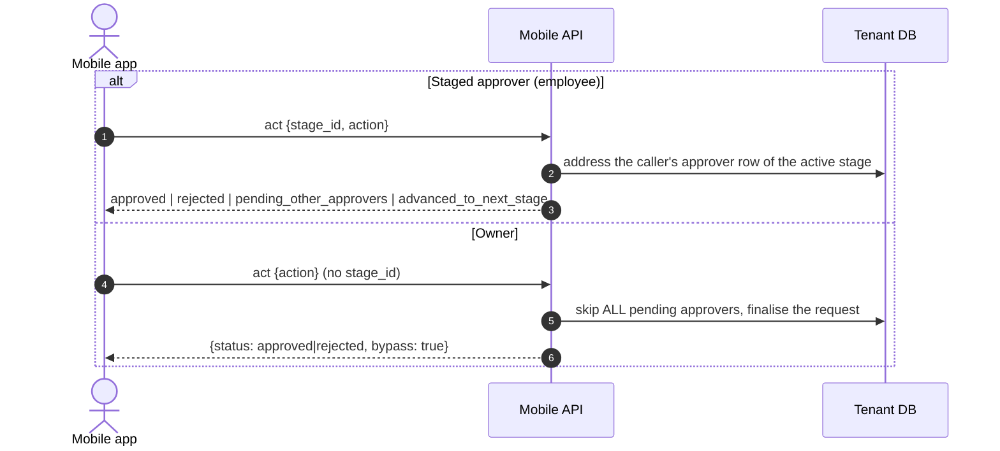

# Owner Access — `fio_backend_client`

> How an **owner** account behaves on the mobile API, what the Dart client exposes
> for it, and which calls an owner must not make.

---

## Table of Contents

1. [Overview](#1-overview)
2. [Which Role Am I?](#2-which-role-am-i)
3. [Read Access](#3-read-access)
4. [Approval Bypass](#4-approval-bypass)
5. [Audit Trail](#5-audit-trail)
6. [Employee-Only Endpoints](#6-employee-only-endpoints)
7. [Complete Example](#7-complete-example)
8. [Error Reference](#8-error-reference)
9. [Backend Reference](#9-backend-reference)

---

## 1. Overview

An owner is a company-wide manager. Unlike an employee, an owner does **not**
need to be linked to an employee record, and in most companies is not. That has
two consequences for the app:

| | Employee | Owner |
|---|---|---|
| Employee record | required, `is_active = true` | **not required** |
| Read scope | self + direct subordinates | whole company |
| Approval scope | only requests where they are a staged approver | **every** request of the company |
| Approval effect | advances one stage | **terminal immediately** (bypass) |
| Self-service writes (attendance, GPS ping, leave, overtime, face registry, profile) | allowed | **not available** without an employee record |

An owner session therefore behaves like a **read + approve** client: monitoring
screens work, every submission screen does not.

> An owner that *does* have an employee record keeps employee behaviour on write
> routes and still gets the company-wide read scope and the approval bypass.

---

## 2. Which Role Am I?

The role is carried by the company token. Read it from the company list (or the
token response) and keep it in app state — the client does not store it for you:

```dart
final companies = await client.user.listCompanies();
final selected = companies.first;

client.setBackendBaseUrl(selected.baseUrl);
client.setCurrentCompany(selected.id);

final companyToken = await client.auth.issueCompanyToken(
  IssueCompanyTokenRequest(
    companyId: selected.id,
    role: selected.role, // "employee" or "owner"
    deviceUniqueIdentifier: deviceId,
    fcmToken: fcmToken,
  ),
);

// Authoritative role for the session:
final bool isOwner = companyToken.role == 'owner';
```

`subadmin` and `admin` cannot obtain a mobile token at all, so
`MobileCompany.role` / `IssueCompanyTokenResponse.role` is always either
`"employee"` or `"owner"`.

---

## 3. Read Access

These services work for an owner without an employee record, scoped to the whole
company. Pass the optional employee filter to narrow the view.

| Service method | Owner filter parameter |
|---|---|
| `client.offices.getMyOffices()` | — (all offices) |
| `client.employees.list(...)` | `ListEmployeesParams.employeeId` |
| `client.employees.detail(id)` | — |
| `client.employeeAttendance.list(...)` | `ListAttendanceParams.employeeId` |
| `client.employeeAttendance.detail(id)` | — |
| `client.location.listSessions(...)` | `ListSessionsParams.employeeId` |
| `client.location.getSessionDetail(id)` | — |
| `client.location.queryHistory(...)` | `QueryHistoryParams.employeeId` |
| `client.location.listSpots()` | — |

```dart
// Owner monitoring: everybody's pings for one day, one employee at a time
final history = await client.location.queryHistory(QueryHistoryParams(
  page: 1,
  pageSize: 100,
  startDate: '2026-10-26',
  endDate: '2026-10-26',
  employeeId: selectedEmployeeId, // optional; omit for all employees
));
```

Feature gates (`location_monitoring`, `geofences`, …) are per employee seat, so
they do not apply to an owner without an employee record.

---

## 4. Approval Bypass

`POST /mobile/v1/my-approvals/{id}/act` behaves differently per role.



**Rule: never send `stage_id` for an owner.** It is ignored, but the UI should
not pretend a stage is being acted on — an owner decision is final.

```dart
// Employee: act on the current stage
await client.myApprovals.act(
  request.id,
  ApprovalActionRequest(
    stageId: request.currentStageId, // required
    action: ApprovalAction.approved,
    notes: 'ok',
  ),
);

// Owner: final decision, no stage
final result = await client.myApprovals.act(
  request.id,
  ApprovalActionRequest(
    action: ApprovalAction.approved,
    notes: 'approved by owner',
  ),
);
assert(result.isBypass); // true
```

### Listing for an owner

An owner is not a staged approver, so the employee-oriented `status` filter does
not apply. Use `requestStatus` (request status) and `employeeId` (requester):

```dart
// Actionable queue (backend default: IN_PROGRESS)
final pending = await client.myApprovals.list();

// History of every request, any status
final everything = await client.myApprovals.list(ListApprovalsParams(
  requestStatus: 'ALL',
  pageSize: 50,
));

// Only rejected, for one requester
final rejected = await client.myApprovals.list(ListApprovalsParams(
  requestStatus: ApprovalRequestStatus.rejected.value,
  employeeId: employeeId,
));

// Anything except the default actionable queue
final approved = await client.myApprovals.list(ListApprovalsParams(
  requestStatus: ApprovalRequestStatus.approved.value,
));
```

Only `IN_PROGRESS` requests are actionable. Acting on a terminal request returns
`400`.

### Domain effect

A bypass writes the same terminal status a web admin bypass would:

| Request type | Approved | Rejected |
|---|---|---|
| `GPS_ATTENDANCE` | `attendance_logs.approval_status = admin_approved` | `rejected` |
| `LEAVE` | `leave_requests.status = admin_approved` | `rejected` |
| `OVERTIME` | `overtime_requests.status = admin_approved` | `rejected` |

`admin_approved` already counts as approved in compute and reporting, so an owner
decision needs no extra step. The `actions` audit trail is what distinguishes an
owner decision from an admin one.

---

## 5. Audit Trail

`GET /mobile/v1/my-approvals/{id}` returns `actions` — every decision taken
**outside** the staged flow. Staged approver decisions stay on
`ApprovalRequest.stages[*].approvers` and are not duplicated.

```dart
final detail = await client.myApprovals.detail(requestId);

for (final action in detail.actions ?? const <ApprovalAuditAction>[]) {
  print('${action.actorName} (${action.actorRole.value}) '
      '${action.action.value} at stage ${action.stageId}');
}
```

| Field | Meaning |
|---|---|
| `actorName` | display name snapshotted at decision time |
| `actorRole` | `owner`, `admin`, `subadmin`, or `employee` |
| `actorUserId` | account that acted |
| `actorEmployeeId` | employee record of the actor, when linked |
| `stageId` | stage that was active when the bypass happened |
| `action` | `Approved` or `Rejected` |
| `isBypass` | always `true` in the current contract |
| `notes`, coordinates | whatever the app sent with the decision |

`ApprovalRequest.isBypassed` is a shortcut for "at least one bypass action".

```dart
if (detail.isBypassed) {
  // Label the decision as final and show the actor, not a pending stage
}
```

---

## 6. Employee-Only Endpoints

These require an employee record and return `403 employee account is inactive`
for an owner account that is not linked to one. In an owner session, hide or
disable them instead of letting the request fail.

| Service method | Endpoint |
|---|---|
| `client.gpsAttendance.getSettings()` / `submit()` / `uploadEvidence()` | `/gps-attendance*` |
| `client.location.submitPing()` / `submitBatch()` / `startSession()` / `updateSession()` | `/location/ping`, `/location/batch`, `/location/sessions` |
| `client.myAttendance.list()` / `detail()` | `/my-attendance*` |
| `client.leave.list()` / `detail()` / `submit()` | `/leave-requests*` |
| `client.leave.listTypes()` | `/leaves` (feature-gated, data is company-wide) |
| `client.overtime.list()` / `detail()` / `submit()` | `/overtime-requests*` |
| `client.faceRegistry.get()` / `register()` | `/face-registry` |
| `client.userProfile.update()` | `/user/update` |
| `client.features.getMyFeatures()` | `/my-features` |

`face-registry` is the one exception for an owner that *does* have an employee
record: that owner may register or read another employee's face photo via
`target_employee_id`. It is unreachable for an employee.

An owner can still be an approver of a leave/overtime request submitted by
somebody else — approving is not the same as submitting.

---

## 7. Complete Example

```dart
class ApprovalScreenModel {
  ApprovalScreenModel(this.client, this.isOwner);

  final MobileApiClient client;
  final bool isOwner;

  Future<List<ApprovalRequest>> load() async {
    final page = await client.myApprovals.list(
      isOwner
          ? const ListApprovalsParams() // IN_PROGRESS queue
          : const ListApprovalsParams(status: 'PENDING'),
    );
    return page.data;
  }

  Future<ApprovalActionResponse> decide(
    ApprovalRequest request, {
    required bool approve,
    String? notes,
  }) {
    return client.myApprovals.act(
      request.id,
      ApprovalActionRequest(
        // Owner bypasses the flow; a staged approver must name the stage.
        stageId: isOwner ? null : request.currentStageId,
        action: approve ? ApprovalAction.approved : ApprovalAction.rejected,
        notes: notes,
      ),
    );
  }
}
```

---

## 8. Error Reference

| Status | `ApiError.message` | Cause |
|---|---|---|
| 400 | `request is no longer actionable` | request already approved/rejected/cancelled |
| 400 | `stage_id is required` / `stage is not the currently active stage…` | staged approver did not send the active stage |
| 400 | `invalid request_status` | `ListApprovalsParams.requestStatus` is not a status or `ALL` |
| 403 | `employee account is inactive` | endpoint requires an employee record (see §6) |
| 403 | `forbidden: you are not a pending approver for this stage` | employee is not an approver of that stage |
| 404 | `request not found` | request does not exist in the token's company |
| 403 | `feature not available` | employee seat lacks the feature (never an owner without an employee) |

---

## 9. Backend Reference

Authoritative backend documents:

- `fio-web-desktop-backend/docs/MOBILE_OWNER_ACCESS.md` — the access matrix and
  the staged-vs-owner approval comparison.
- `fio-web-desktop-backend/docs/MOBILE_OWNER_ACCESS_PLAN.md` — implementation
  plan and phase log.
- `internal/http/routes/mobileroute.go` — which middleware guards each route.
